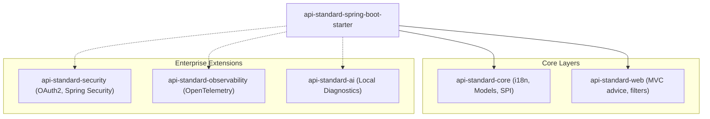

# V2.0 Modular Architecture (Planning) 🏗️

This document defines the technical specifications and design decisions for the next-generation (**V2.0**) of the error intelligence and standardization platform.

---

## 1. Module Vision (Split)

To prevent unnecessary coupling and dependency bloat (*scope creep*), the starter will be split into independent modules under a federated architecture:



### Module Responsibility Table

| Module | Type | Key Dependencies | Purpose |
| :--- | :--- | :--- | :--- |
| `api-standard-core` | Core | `jakarta.servlet-api` (optional) | Definition of `ErrorCode`, `BusinessException`, and the `ProblemDetailEnricher` SPI. |
| `api-standard-web` | Core | `spring-webmvc` | Global `@RestControllerAdvice` and MVC trace filters. |
| `api-standard-security` | Ext | `spring-security` | Automatic translation of authentication/authorization exceptions (`AccessDeniedException`) to RFC 9457. |
| `api-standard-observability` | Ext | `micrometer-tracing`, `opentelemetry` | Alignment with OTel semantic conventions and exporting error metrics. |
| `api-standard-ai` | Ext | None (Local only) | Assisted diagnostics and safe context analysis of the error. |

---

## 2. Mesh-Awareness

In modern microservice architectures, a Service Mesh (such as Istio or Linkerd) or an API Gateway (such as Kong or Spring Cloud Gateway) often intercepts and retries requests based on HTTP status codes. 

V2.0 introduces **Mesh-Awareness**:

1. **Network Header Detection**: The starter reads headers like `X-Envoy-Expected-Rq-Timeout-Ms` or `X-Forwarded-For`.
2. **Network Context Propagation**: If it detects that the request originates from a sidecar proxy, it dynamically adjusts the error structure to avoid infinite retry loops, injecting specific control headers like `X-Mesh-Error-Code`.

---

## 3. Contract Governance (Governance-as-Code) 🛡️

To ensure organizational consistency and prevent leaking unlocalized technical error codes to production clients, **V2.0** introduces the automatic startup **i18n Translation Validation**:

### How It Works
Upon application startup, the `TranslationValidator` component scans all codes declared in the `ErrorCode` enum and automatically verifies that their corresponding localized messages are present in `messages.properties` (English/Default) and `messages_es.properties` (Spanish) bundles.

```
[App Startup] ──> [TranslationValidator]
                        │
                        ├──> Has key "error.CODE"?
                        │
                        ├──> NO ──> Is strict-translation-check = true?
                        │                 │
                        │                 ├──> YES ──> Throw IllegalStateException (Crash App)
                        │                 └──> NO ──> Log giant WARN alert in Console ⚠️
                        │
                        └──> YES ──> Log INFO ("All codes translated")
```

### Modes of Operation

#### 1. Friendly Warning Mode (Default)
If any translation key is missing but the property `api.standard.errors.strict-translation-check` is set to `false`, the system prints a beautiful, high-visibility warning block in the startup logs at `WARN` level without crashing the application.

* **Log Output Example**:
  ```text
  ====================================================================
  ⚠️  API STANDARD I18N VALIDATION WARNING  ⚠️
  Some canonical ErrorCodes are missing translations in properties files.
  Missing ENGLISH translations (messages.properties):
    - error.GONE
    - error.CONFLICT
  Missing SPANISH translations (messages_es.properties):
    - error.GONE
    - error.CONFLICT
  ====================================================================
  ```

#### 2. Strict Enforcement Mode (Recommended for CI/CD Gates)
When enabling this property in your `application.yml`:
```yaml
api:
  standard:
    errors:
      strict-translation-check: true
```
Any missing translation key will cause the application **to fail hard during startup**, blocking invalid deployments in your pipeline and ensuring strict governance across the organization.

---

## 4. OpenTelemetry (OTel) Alignment

The `api-standard-observability` module deterministically maps RFC 9457 error fields to the telemetry context:

* **Span Events**: Records the complete exception as an official span event by calling `recordException(ex)` to natively capture the stacktrace in the OTel collector.
* **Span Attributes**: Each registered error enriches the active span with standard semantic attributes:
  * `exception.type` -> Java exception class name.
  * `exception.message` -> Response `detail`.
  * `error.code` -> Canonical `ErrorCode` (e.g., `VALIDATION_ERROR`).
