# Fundamental Concepts

Understanding the internal architecture of `api-standard-spring-boot-starter` is key to extending it and using it effectively in production.

This library is built upon the **Open/Closed Principle (OCP)** and acts as a non-intrusive layer over Spring MVC.

---

## Internal Architecture & Pipeline

The error handling process follows a strict, predictable pipeline designed to standardize every exception thrown during an HTTP request.

### The Lifecycle

```mermaid
sequenceDiagram
    participant Client
    participant Controller
    participant GlobalExceptionHandler
    participant ProblemDetailService
    participant Enrichers

    Client->>Controller: HTTP Request
    Controller-->>GlobalExceptionHandler: Throws Exception
    GlobalExceptionHandler->>ProblemDetailService: createProblem(status, exception)
    
    rect rgb(30, 40, 50)
    Note over ProblemDetailService,Enrichers: Enrichment Pipeline
    ProblemDetailService->>ProblemDetailService: 1. Resolve i18n Title & Detail
    ProblemDetailService->>ProblemDetailService: 2. Resolve Type URI
    ProblemDetailService->>Enrichers: enrich(problem, request, locale, ex)
    Enrichers-->>ProblemDetailService: Add Custom Metadata (traceId, degraded)
    end
    
    ProblemDetailService-->>GlobalExceptionHandler: Enriched ProblemDetail
    GlobalExceptionHandler-->>Client: JSON Response (RFC 9457)
```

### 1. Interception Phase
The `GlobalExceptionHandler` is a `@RestControllerAdvice` registered with the `Ordered.LOWEST_PRECEDENCE`. This means it will catch any exception not explicitly handled by your own custom `@ControllerAdvice` classes.

It explicitly handles:
*   `ProblemException` (and `BusinessException`).
*   Validation errors (`MethodArgumentNotValidException`, `ConstraintViolationException`).
*   Spring MVC routing errors (404, 405, 415).
*   Resilience4j errors (`CallNotPermittedException`, `RequestNotPermitted`).
*   Any unhandled `Exception` (fallback to 500).

### 2. Processing Phase
The `ProblemDetailService` acts as the core orchestrator. It creates a native Spring `ProblemDetail` object and applies core translations using Spring's `MessageSource`.

### 3. Enrichment Phase (Extensibility)
This is where the library shines. Instead of hardcoding fields like `traceId` or system load indicators into the core service, it delegates to a pipeline of `ProblemDetailEnricher` beans.

The library ships with several built-in enrichers:
*   `StandardMetadataEnricher`: Injects the `code` and `timestamp`.
*   `TraceIdEnricher`: Extracts the correlation ID from the logging MDC.
*   `DegradedModeEnricher`: Injects the `degraded` flag if the CPU load is high.

---

## Threading and Concurrency Model

This library operates entirely within the **standard Servlet thread-per-request model** (e.g., Tomcat, Undertow). 

*   **Stateless**: All handler and service beans are stateless singletons.
*   **No Custom Thread Pools**: The library does not spawn its own threads or asynchronous boundaries. Error processing happens synchronously on the thread that threw the exception, ensuring MDC context (like Trace IDs) remains attached.
*   **Performance**: Object allocations are kept to a minimum in the critical path to avoid adding latency to error responses.

---

## Degraded Mode (Active Load Protection)

The library includes a passive system load indicator.

1.  A `SystemLoadMonitor` (implemented by `DefaultSystemLoadMonitor`) periodically checks the underlying JVM operating system metrics (`OperatingSystemMXBean.getCpuLoad()`).
2.  If the load exceeds the configured threshold (default 80%), a `DegradedModeFilter` adds the `X-API-Degraded: true` header to responses.
3.  Simultaneously, the `DegradedModeEnricher` adds `"degraded": true` to any error JSON emitted.

> [!NOTE]
> If the host OS or JVM does not support `getCpuLoad()` (returning `-1`), the library assumes a normal load state.

---

## Design Principles

*   **RFC 9457 Strictness**: We never mutate the standard top-level fields (`type`, `title`, `status`, `detail`, `instance`) to mean something else. Custom data goes into extended properties.
*   **Open/Closed Principle**: You can add new fields to the JSON by creating a new `ProblemDetailEnricher` bean, without touching the core exception handler.
