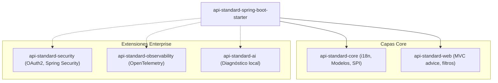

# Arquitectura Modular V2.0 (Planificación) 🏗️

Este documento define las especificaciones técnicas y decisiones de diseño para la próxima generación (**V2.0**) de la plataforma de inteligencia de errores y estandarización.

---

## 1. Visión de Módulos (Split)

Para evitar el acoplamiento innecesario y el crecimiento desmedido de dependencias (*scope creep*), el starter se dividirá en módulos independientes bajo una arquitectura federada:



### Tabla de Responsabilidades por Módulo

| Módulo | Tipo | Dependencias Clave | Propósito |
| :--- | :--- | :--- | :--- |
| `api-standard-core` | Core | `jakarta.servlet-api` (opcional) | Definición de `ErrorCode`, `BusinessException` y el SPI `ProblemDetailEnricher`. |
| `api-standard-web` | Core | `spring-webmvc` | El `@RestControllerAdvice` global y filtros MVC de traza. |
| `api-standard-security` | Ext | `spring-security` | Traducción automática de excepciones de autenticación/autorización (`AccessDeniedException`) a RFC 9457. |
| `api-standard-observability` | Ext | `micrometer-tracing`, `opentelemetry` | Alineación con convenciones semánticas de OTel y exportación de métricas de error. |
| `api-standard-ai` | Ext | None (Local only) | Diagnóstico asistido y análisis seguro del contexto del error. |

---

## 2. Mesh-Awareness (Consciencia de Red)

En arquitecturas de microservicios modernas, un Service Mesh (como Istio o Linkerd) o un API Gateway (como Kong o Spring Cloud Gateway) a menudo interceptan y reintentan peticiones basadas en los códigos de estado HTTP. 

La V2.0 introduce **Mesh-Awareness**:

1. **Detección de Headers de Red**: El starter lee cabeceras como `X-Envoy-Expected-Rq-Timeout-Ms` o `X-Forwarded-For`.
2. **Propagación del Contexto de Red**: Si detecta que la petición proviene de un sidecar proxy, ajusta dinámicamente la estructura del error para evitar colisiones de reintentos infinitos, inyectando cabeceras de control específicas como `X-Mesh-Error-Code`.

---

## 3. Gobernanza de Contratos (Governance-as-Code) 🛡️

Para asegurar la consistencia organizativa y evitar que se filtren códigos de error técnicos no localizados a los clientes en producción, la **V2.0** introduce el validador automático de internacionalización en tiempo de arranque (**i18n Translation Validation**):

### Mecanismo de Funcionamiento
Al iniciar la aplicación, el componente `TranslationValidator` escanea todos los códigos declarados en el enum `ErrorCode` y verifica de forma automática que tengan sus respectivas traducciones en los bundles `messages.properties` (Inglés/Default) y `messages_es.properties` (Español).

```
[Arranque de App] ──> [TranslationValidator]
                            │
                            ├──> ¿Tienen llave "error.CODE"?
                            │
                            ├──> NO ──> ¿strict-translation-check = true?
                            │                  │
                            │                  ├──> SÍ ──> Lanzar IllegalStateException (Cerrar App)
                            │                  └──> NO ──> Loguear WARN gigante en la Consola ⚠️
                            │
                            └──> SÍ ──> Loguear INFO ("All codes translated")
```

### Modos de Operación

#### 1. Modo Amigable / Advertencia (Por Defecto)
Si alguna traducción falta pero la propiedad `api.standard.errors.strict-translation-check` es `false`, el sistema imprime un bloque de alerta en los logs a nivel de `WARN` sin interrumpir la ejecución.

* **Ejemplo de Salida en Log**:
  ```text
  ====================================================================
  ⚠️  API STANDARD I18N VALIDATION WARNING  ⚠️
  Some canonical ErrorCodes are missing translations in properties files.
  Missing ENGLISH translations (messages.properties):
    - error.GONE
    - error.CONFLICT
  Missing SPANISH translations (messages_es.properties):
    - error.GONE
    - error.CONFLICT
  ====================================================================
  ```

#### 2. Modo Estricto (Ideal para Entornos de Integración / CI)
Al activar la propiedad en tu `application.yml`:
```yaml
api:
  standard:
    errors:
      strict-translation-check: true
```
Cualquier código de error sin traducción provocará que la aplicación **falle duro durante el arranque**, impidiendo despliegues defectuosos a producción y asegurando el cumplimiento estricto del estándar organizativo.

---

## 4. Alineación con OpenTelemetry (OTel)

El módulo `api-standard-observability` mapea de forma determinista los campos del error RFC 9457 al contexto de telemetría:

* **Span Events**: Registra la excepción completa como un evento de span oficial llamando a `recordException(ex)` para capturar de forma nativa el stacktrace en el colector de OTel.
* **Span Attributes**: Cada error registrado enriquece el span actual con atributos semánticos estándar:
  * `exception.type` -> Nombre de la excepción de Java.
  * `exception.message` -> El `detail` de la respuesta.
  * `error.code` -> El `ErrorCode` canónico (ej. `VALIDATION_ERROR`).
