# Conceptos Fundamentales

Comprender la arquitectura interna de `api-standard-spring-boot-starter` es clave para extenderlo y utilizarlo eficazmente en producción.

Esta librería está construida bajo el **Principio Abierto/Cerrado (OCP)** y actúa como una capa no intrusiva sobre Spring MVC.

---

## Arquitectura Interna y Pipeline

El proceso de manejo de errores sigue un pipeline estricto y predecible, diseñado para estandarizar cada excepción lanzada durante una petición HTTP.

### El Ciclo de Vida (Lifecycle)

```mermaid
sequenceDiagram
    participant Client
    participant Controller
    participant GlobalExceptionHandler
    participant ProblemDetailService
    participant Enrichers

    Client->>Controller: Petición HTTP
    Controller-->>GlobalExceptionHandler: Lanza Excepción
    GlobalExceptionHandler->>ProblemDetailService: createProblem(status, exception)
    
    rect rgb(30, 40, 50)
    Note over ProblemDetailService,Enrichers: Pipeline de Enriquecimiento
    ProblemDetailService->>ProblemDetailService: 1. Resuelve Título y Detalle (i18n)
    ProblemDetailService->>ProblemDetailService: 2. Resuelve URI del Type
    ProblemDetailService->>Enrichers: enrich(problem, request, locale, ex)
    Enrichers-->>ProblemDetailService: Agrega Metadatos (traceId, degraded)
    end
    
    ProblemDetailService-->>GlobalExceptionHandler: ProblemDetail Enriquecido
    GlobalExceptionHandler-->>Client: Respuesta JSON (RFC 9457)
```

### 1. Fase de Intercepción
El `GlobalExceptionHandler` es un `@RestControllerAdvice` registrado con `Ordered.LOWEST_PRECEDENCE`. Esto significa que capturará cualquier excepción que no haya sido manejada explícitamente por tus propios `@ControllerAdvice` personalizados.

Maneja explícitamente:
*   `ProblemException` (y `BusinessException`).
*   Errores de validación (`MethodArgumentNotValidException`, `ConstraintViolationException`).
*   Errores de enrutamiento de Spring MVC (404, 405, 415).
*   Errores de Resilience4j (`CallNotPermittedException`, `RequestNotPermitted`).
*   Cualquier `Exception` no manejada (fallback a 500).

### 2. Fase de Procesamiento
El `ProblemDetailService` actúa como el orquestador central. Crea un objeto nativo `ProblemDetail` de Spring y aplica las traducciones base utilizando el `MessageSource` de Spring.

### 3. Fase de Enriquecimiento (Extensibilidad)
Aquí es donde brilla la librería. En lugar de quemar en código campos como el `traceId` o indicadores de carga del sistema en el servicio core, delega a un pipeline de beans `ProblemDetailEnricher`.

La librería incluye varios enriquecedores integrados:
*   `StandardMetadataEnricher`: Inyecta el `code` legible por máquina y el `timestamp`.
*   `TraceIdEnricher`: Extrae el ID de correlación del MDC de logs.
*   `DegradedModeEnricher`: Inyecta el flag `degraded` si la carga de CPU es alta.

---

## Modelo de Hilos y Concurrencia

Esta librería opera enteramente dentro del **modelo estándar de un hilo por petición de Servlet** (ej. Tomcat, Undertow).

*   **Sin estado (Stateless)**: Todos los handlers y servicios son singletons sin estado.
*   **Sin hilos personalizados**: La librería no levanta sus propios hilos ni crea barreras asíncronas. El procesamiento de errores ocurre de manera síncrona en el hilo que lanzó la excepción, asegurando que el contexto MDC (como los Trace IDs) permanezca adjunto.
*   **Rendimiento**: Las alocaciones de objetos se mantienen al mínimo en la ruta crítica para evitar agregar latencia a las respuestas de error.

---

## Modo Degradado (Protección Activa de Carga)

La librería incluye un indicador pasivo de carga del sistema.

1.  Un `SystemLoadMonitor` (implementado por `DefaultSystemLoadMonitor`) revisa periódicamente las métricas del sistema operativo de la JVM (`OperatingSystemMXBean.getCpuLoad()`).
2.  Si la carga excede el umbral configurado (80% por defecto), un `DegradedModeFilter` agrega la cabecera `X-API-Degraded: true` a las respuestas.
3.  Simultáneamente, el `DegradedModeEnricher` agrega `"degraded": true` a cualquier JSON de error emitido.

> [!NOTE]
> Si el SO anfitrión o la JVM no soportan `getCpuLoad()` (retornando `-1`), la librería asume por defecto un estado de carga normal.

---

## Principios de Diseño

*   **Estrictez RFC 9457**: Nunca mutamos los campos estándar de primer nivel (`type`, `title`, `status`, `detail`, `instance`) para que signifiquen otra cosa. Los datos personalizados van en propiedades extendidas.
*   **Principio Abierto/Cerrado (OCP)**: Puedes agregar nuevos campos al JSON creando un nuevo bean `ProblemDetailEnricher`, sin tocar el manejador de excepciones principal.
